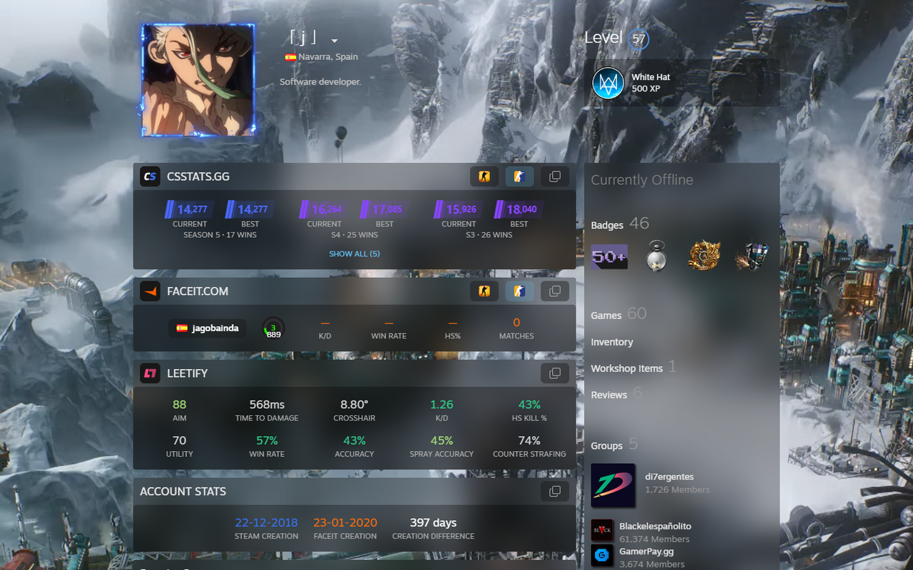
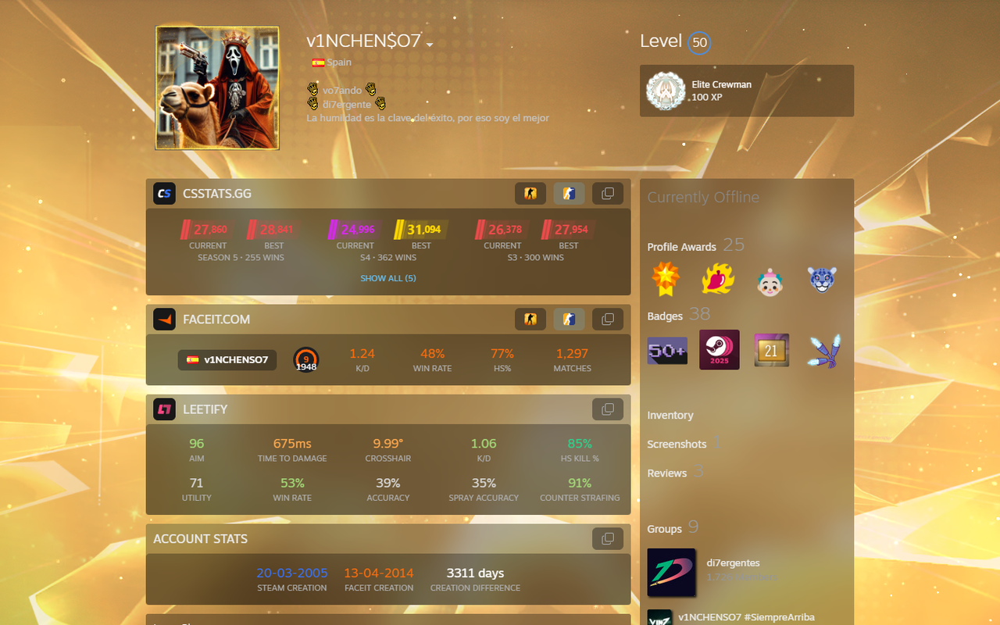
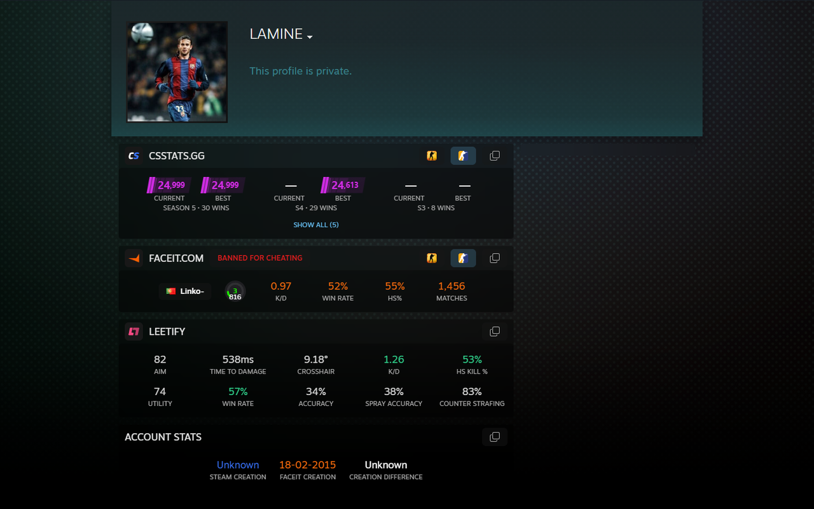

<div align="center">


# Counter-Strike Stats

**Displays Counter-Strike stats directly on Steam profiles.**

csstats.gg · FACEIT · Leetify, right where you check who you're playing with or against.

[](https://chromewebstore.google.com/detail/nklafihgaifhoahbfcfiaemfmpoplkch)
[](https://addons.mozilla.org/firefox/addon/counter-strike-stats/)

[](https://github.com/jagobainda/CounterStrikeStatsExtension/actions/workflows/ci.yml)
[](https://github.com/jagobainda/CounterStrikeStatsExtension/releases/latest)
[](LICENSE)



</div>

## What it shows

Open any Steam profile and the extension adds these sections at the top:

| Section           | Stats                                                                                                                                                                                                                          |
| ----------------- | ------------------------------------------------------------------------------------------------------------------------------------------------------------------------------------------------------------------------------ |
| **CSSTATS.GG**    | Wins, current rating and best rating for every Premier season (the 3 most recent are shown, the rest with "Show all"). Last and best CS:GO competitive rank, and CS:GO matchmaking wins.                                       |
| **FACEIT**        | Nickname and country, level and ELO. K/D, win rate, headshot percentage and matches, separately for CS2 and CS:GO. A warning if the account is banned.                                                                         |
| **LEETIFY**       | Aim, time to damage, crosshair placement, K/D and headshot kill percentage. Utility, win rate, accuracy, spray accuracy and counter-strafing. Each value is colored by how it compares to the average player; hover to see it. |
| **ACCOUNT STATS** | Steam account creation date, FACEIT account creation date and the number of days between them.                                                                                                                                 |

## Features

- 🎮 Switch between CS2 and CS:GO stats with one click
- 📋 Copy any section's stats to the clipboard
- 🔗 Every section links to the player's page on the source site
- 🚫 If a source has no data for a player, the section says so instead of showing empty values

## Screenshots

<p align="center">
  
  
</p>

## Privacy

The extension only runs on Steam profile pages. It reads the Steam ID of the profile you're viewing and requests that player's public stats from csstats.gg, FACEIT and Leetify. It has no servers of its own, and it doesn't collect, store or share any of your data.

## Development

Requires Node.js 24. The extension has no runtime dependencies.

```bash
npm ci
npm test       # node:test suites with real response fixtures
npm run lint   # web-ext lint
npm run format # Prettier
```

Load the repository folder as an unpacked extension (`chrome://extensions` → Developer mode → Load unpacked, or `about:debugging` → Load Temporary Add-on in Firefox). On Windows, `build.bat` creates the zip that is uploaded to both stores.

## License

[MIT](LICENSE). Counter-Strike Stats is not affiliated with Valve, csstats.gg, FACEIT or Leetify.
